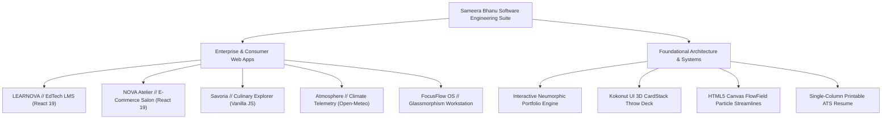
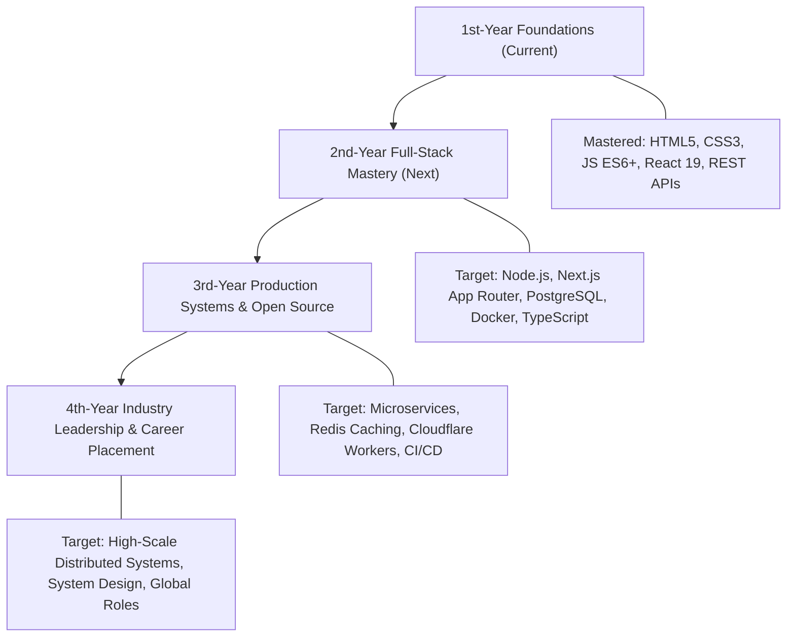

# Comprehensive Project Portfolio & Engineering Architecture Guide
### Developer: Sameera Bhanu • B.Tech in Information Technology (1st Year)
**Institution:** [Shri Vishnu Engineering College for Women (SVECW)](https://www.linkedin.com/school/15124808/), Bhimavaram  
**Live Portfolio:** [sksameera321.github.io/interactive-resume-portfolio/](https://sksameera321.github.io/interactive-resume-portfolio/)  
**ATS Resume:** [sksameera321.github.io/interactive-resume-portfolio/resume.html](https://sksameera321.github.io/interactive-resume-portfolio/resume.html)  
**GitHub Profile:** [github.com/sksameera321](https://github.com/sksameera321)  

---

## Executive Overview

This engineering document provides an exhaustive breakdown of all software and web development projects engineered by **Sameera Bhanu**. For each project, it analyzes:
1. **Project Vision & Feature Architecture**: Real-world utility, user workflows, and core mechanics.
2. **Complete Technical Stack**: Languages, frameworks, runtime libraries, external APIs, and state persistence patterns.
3. **Industry Vertical & Domain Categorization**: Standard market taxonomy, sector classification, and commercial context.
4. **Future Improvement Roadmap**: High-impact architectural upgrades, backend/database integrations, scalability paths, and AI/ML capabilities.

---

## Summary Comparison Matrix

| Project | Assignment | Primary Tech Stack | Industry Vertical | Commercial Domain | Live Deployment |
| :--- | :---: | :--- | :--- | :--- | :---: |
| **[LEARNOVA LMS](#1-learnova--modern-learning-management-platform)** | Assgn 05 | React 19, Vite, React Router, Canvas Confetti, Lucide Icons | **EdTech (Educational Technology)** | Learning Management Systems (LMS) & Credentialing | [Live Demo](https://sksameera321.github.io/learnova-lms/) |
| **[NOVA Atelier](#2-nova-atelier--modern-luxury-e-commerce-experience)** | Assgn 04 | React 19, Vite, React Router, Context API, DummyJSON API | **Luxury Fashion & Retail** | E-Commerce, Digital Storefront & Omnichannel | [Live Demo](https://sksameera321.github.io/nova-ecommerce/) |
| **[Savoria Culinary](#3-savoria--culinary-explorer--recipe-discovery)** | Assgn 03 | Semantic HTML5, CSS3, Vanilla JS (ES6+), DummyJSON Recipes | **FoodTech & Hospitality** | Recipe Discovery, Kitchen Assistant & Meal Prep | [Live Demo](https://sksameera321.github.io/recipe-discovery/) |
| **[Atmosphere](#4-atmosphere--real-time-weather-explorer)** | Assgn 02 | HTML5, CSS Grid/Flexbox, Vanilla JS Modules, Open-Meteo API | **ClimateTech & Data Intelligence** | Meteorological Telemetry & Geospatial Weather | [Live Demo](https://sksameera321.github.io/weather-application/) |
| **[FocusFlow OS](#5-focusflow-os--personal-productivity-dashboard)** | Assgn 01 | HTML5, CSS3, Vanilla JS (ES6+), Frosted Glassmorphism | **Enterprise SaaS & Productivity** | Personal Knowledge Management (PKM) & Task Ops | [Live Demo](https://sksameera321.github.io/personal-productivity-dashboard/) |
| **[Interactive Portfolio](#6-interactive-developer-portfolio--ats-resume)** | Core Showcase | Vanilla JS, Neumorphism CSS3, Canvas API, Kokonut UI | **Developer Tools & Creative Tech** | Personal Branding, UI Engineering & Design Systems | [Live Demo](https://sksameera321.github.io/interactive-resume-portfolio/) |

---

---

## 1. LEARNOVA — Modern Learning Management Platform

### A. Project Overview & Architecture
**LEARNOVA** is a high-performance, next-generation Learning Management System (LMS) built from the ground up for modern computing disciplines (Autonomous AI Agents, Distributed Consensus, React 19 Server Architecture, and Zero-Trust Cybersecurity).

Unlike conventional static slide-deck portals, LEARNOVA acts as a unified engineering learning workspace:
- **Distraction-Free Video Theatre**: High-definition video player with multi-speed controls (1x, 1.25x, 1.5x, 2x) and full player state synchronization.
- **Module Scratchpad**: Live student scratchpad integrated beside lecture media that auto-saves markdown notes directly into `localStorage` on every keystroke.
- **Certification Exam Engine**: Interactive evaluation engine with randomized multiple-choice assessment, real-time question timers, 75% passing threshold, and pedagogical answer explanations.
- **Verifiable Official Diplomas**: Dynamic SVG and HTML certificate engine generating cryptographically structured verification hashes, date stamps, and dedicated print stylesheets for instant PDF export.
- **Student Progress Telemetry**: Visual tracking for active study streaks, earned XP points, module milestones, and syllabus completion percentages.

### B. Technical Stack
- **Frontend Framework:** `React 19 (19.x)`
- **Build Tool & Bundler:** `Vite` (Lightning-fast HMR and optimized ES modules production build)
- **Routing & Navigation:** `React Router v7 (react-router-dom)` with nested routes and stateful deep links
- **Iconography & Graphics:** `lucide-react` (Crisp, zero-bloat vector icons)
- **Visual Effects:** `canvas-confetti` (High-performance particle burst on exam graduation)
- **Styling Architecture:** Modern modular CSS3 with obsidian cyber-editorial design tokens, skeuomorphic physical controls, and responsive grid layouts
- **State Management & Persistence:** React Context API + Browser `localStorage`
- **Code Quality:** `oxlint` for rapid static analysis

### C. Industry Classification
- **Primary Industry:** **EdTech (Educational Technology)**
- **Secondary Industry:** **Higher Education & Corporate Learning & Development (L&D)**

### D. Domain Classification
- **Domain:** **E-Learning & Learning Management Systems (LMS)**
- **Sub-Domains:** Digital Assessment & Testing, Continuing Professional Education (CPE), Verifiable Digital Credentialing, Student Performance Analytics

### E. Further Improvements & Future Roadmap
> [!TIP]
> Transforming LEARNOVA into an enterprise SaaS platform requires shifting from client-side state to a durable multi-tenant backend with real-time video streaming.

1. **Backend & Database Infrastructure**:
   - Migrate student profiles and course catalogs to a scalable database like **PostgreSQL** via **Prisma ORM** or **Supabase**.
   - Implement **JWT / OAuth2 authentication** (GitHub, Google, University SSO) with Role-Based Access Control (RBAC: Student, Instructor, Admin, Dean).
2. **Interactive Coding Sandbox & Automated Code Grading**:
   - Embed an in-browser code editor (Monaco Editor / WebContainers) allowing students to solve live coding assignments and test code directly in the browser.
3. **AI-Powered Personalized Tutor**:
   - Integrate an LLM copilot (Gemini API) capable of reading lesson transcripts and answering student questions in context when they pause a video.
4. **Live Discussion & Peer Channels**:
   - Build real-time thread discussions per lesson powered by **WebSockets** or **Socket.io** to enable peer troubleshooting.
5. **Video Streaming Infrastructure**:
   - Transition from static video links to **HLS (HTTP Live Streaming)** with adaptive bitrate streaming using Cloudflare Stream or AWS Elemental MediaConvert.

---

## 2. NOVA Atelier — Modern Luxury E-Commerce Experience

### A. Project Overview & Architecture
**NOVA Atelier** is a modern luxury e-commerce platform engineered as a digital fashion and horology salon. It combines editorial aesthetics with tactile physical UI interactions.

Key architectural features include:
- **Curated Multi-Category Catalog**: Ready-to-wear runway collections, Swiss horological complications, and Tuscan leather accessories.
- **RESTful API Integration**: Dynamically pulls product records, stock levels, high-res galleries, ratings, and customer reviews from the DummyJSON Products REST API.
- **Real-Time Currency Engine**: Formats and computes all item prices, shipping surcharges, taxes, and discounts in Indian Rupee (`INR ₹`) with dynamic exchange rate scaling.
- **Persistent Slide-Over Cart Drawer**: Floating cart modal with quantity increments/decrements, interactive free-shipping progress meter, and `localStorage` state persistence.
- **Multi-Stage Simulated Checkout**: Complete checkout funnel with shipping address validation, payment method selector (Cards, UPI, Net Banking), coupon code engine, and printable order invoice.
- **Tactile UI Controls**: Subtle Skeuomorphic embossed buttons, debossed input wells, and Neumorphic flat cards.

### B. Technical Stack
- **Frontend Framework:** `React 19 (19.x)`
- **Build Tool:** `Vite`
- **Routing:** `React Router v7` with dynamic route parameters (`/product/:id`) and URL search params (`?category=...&sort=...`)
- **State Architecture:** Multi-Context architecture:
  - `CartContext`: Cart items, quantity mutations, price aggregations
  - `WishlistContext`: Favorited items with persistent state
  - `ToastContext`: Dynamic notifications for cart operations
- **External Data Source:** `DummyJSON REST API` (Products, Categories, Ratings, Specs)
- **Styling Architecture:** Pure CSS3 custom design tokens (Champagne Gold `#c5a059`, Deep Obsidian `#0a0b0e`, Silk Ivory `#f8f6f0`), Flexbox, CSS Grid, and media queries
- **Iconography:** `lucide-react`

### C. Industry Classification
- **Primary Industry:** **Retail & Luxury Goods**
- **Secondary Industry:** **Fashion & Haute Horology**

### D. Domain Classification
- **Domain:** **E-Commerce & Digital Storefronts**
- **Sub-Domains:** Omnichannel Retailing, Shopping Cart State Architecture, Payment Gateway UX, Inventory Merchandising

### E. Further Improvements & Future Roadmap
> [!TIP]
> E-Commerce platforms scale based on conversion optimization, frictionless checkout, and recommendation relevance.

1. **Real Payment Gateway Integration**:
   - Integrate **Razorpay / Stripe API** (with Webhooks) to process authentic test credit cards, UPI intent flows, and generate genuine merchant transaction receipts.
2. **Server-Side Rendering (SSR) & SEO Optimization**:
   - Migrate to **Next.js (App Router)** or **Remix** for server-side product rendering, dynamic Open Graph tags per SKU, and sub-second Largest Contentful Paint (LCP).
3. **AI Virtual Stylist & Recommendation Engine**:
   - Implement collaborative filtering or vector embeddings (Gemini Embeddings) to surface *"Complete the Look"* pairings (e.g. matching shoes with a handbag).
4. **Order Tracking & Inventory Sync**:
   - Integrate a headless CMS (Sanity / Strapi / Shopify Storefront API) and build an interactive shipment tracking portal with map pins and carrier milestones.
5. **Augmented Reality (AR) Watch/Accessory Try-On**:
   - Utilize WebXR or Three.js to let users virtually preview watch diameters on their wrists using camera input.

---

## 3. Savoria — Culinary Explorer & Recipe Discovery

### A. Project Overview & Architecture
**Savoria** is a responsive culinary discovery platform and live kitchen cooking assistant built to bridge meal inspiration and hands-on cooking execution.

Key architectural features include:
- **Instant Debounced Discovery**: Dynamic search bar coupled with multi-faceted filtering for world cuisines (Italian, Mexican, Asian, Mediterranean), meal types (Dinner, Breakfast, Snack), difficulty levels, and prep time thresholds.
- **Dynamic Servings Scaler**: Mathematical engine that dynamically re-calculates ingredient measurements when the user adjusts portion count (1 to 24 servings), automatically parsing and rendering mixed fractions (e.g. `1 1/2 cups` or `0.75 tsp`).
- **Interactive Ingredient Prep Checklist**: Clickable checklist allowing home cooks to cross off ingredients as they prep, persisted across page refreshes via browser `localStorage`.
- **Fullscreen Cook Mode**: Dedicated distraction-free step-by-step cooking interface featuring step progress tracking, keyboard navigation (`ArrowRight` / `ArrowLeft`), and an embedded countdown kitchen timer with audio alerts.

### B. Technical Stack
- **Core Languages:** Semantic `HTML5`, Modern `CSS3`, Modular `Vanilla JavaScript (ES6+)`
- **External API:** `DummyJSON Recipes REST API` (50+ international recipes with comprehensive metadata)
- **Data Persistence:** Browser `localStorage` (Preserving active recipe checklist progress and user favorites)
- **Audio Synthesis:** Web Audio API & HTML5 Audio for kitchen timer alerts
- **Layout Architecture:** CSS Grid for recipe cards, Flexbox for modal controls, and custom CSS custom properties (Variables) for theming
- **Zero Framework Bloat:** 100% vanilla JavaScript with zero third-party dependencies

### C. Industry Classification
- **Primary Industry:** **FoodTech (Food Technology)**
- **Secondary Industry:** **Hospitality, Media & Lifestyle Publishing**

### D. Domain Classification
- **Domain:** **Culinary Arts & Cooking Assistance**
- **Sub-Domains:** Recipe Aggregation & Search, Nutritional Planning, Kitchen Utility Tooling, Grocery List Operations

### E. Further Improvements & Future Roadmap
> [!TIP]
> The biggest opportunity in modern cooking apps is bridging recipe discovery with pantry inventory and automated grocery ordering.

1. **Smart Pantry / "Cook What You Have" Feature**:
   - Allow users to enter a list of ingredients currently in their fridge and use an inverted index algorithm or API query to suggest recipes that maximize existing ingredients while minimizing waste.
2. **Automated Nutritional Calculator**:
   - Integrate with the **Edamam Nutrition Analysis API** or **USDA FoodData Central** to dynamically calculate total calories, macro split (Proteins, Fats, Carbs), and micronutrient percentages per scaled serving.
3. **One-Click Grocery Cart Integration**:
   - Integrate with grocery delivery APIs (Blinkit / Zepto / Instacart API) so users can transfer missing ingredients directly into an online cart.
4. **Voice-Guided Cooking**:
   - Integrate Web Speech API (Speech Recognition & Speech Synthesis) so chefs with messy hands can advance cooking steps by saying *"Next Step"* or *"Set Timer for 5 minutes"*.
5. **User-Generated Recipe Creator**:
   - Provide a visual recipe authoring studio where users can publish their own family recipes with photo uploads and tag assignments.

---

## 4. Atmosphere — Real-Time Weather Explorer

### A. Project Overview & Architecture
**Atmosphere** is a production-grade meteorological explorer inspired by Apple Weather's data-dense, minimalist design. It displays real-time atmospheric data with zero static mock fallbacks.

Key architectural features include:
- **100% Live Open-Meteo REST API Queries**: Connects directly to the Open-Meteo European meteorological model with dynamic geocoding for global cities.
- **Dynamic Solar Arc Curves**: Custom visual SVG arc that calculates real-time sun elevation and maps the current solar position between sunrise and sunset times.
- **Hourly Progression Slider**: 24-hour horizontal scroll bar displaying temperature trends, precipitation probability bars, weather condition glyphs, and wind velocity.
- **7-Day Extended Forecast**: Daily forecast cards displaying high/low temperature bar charts with visual gradient fills indicating relative temperature ranges.
- **Comprehensive Climate Metrics Grid**: Atmospheric pressure (hPa), UV index gauge with safety tiering, dew point, visibility distance, relative humidity, and wind compass bearing.
- **Resilient Fallback Pipeline**: Multi-tiered fetch architecture ensuring graceful error handling and offline indicators during network loss.

### B. Technical Stack
- **Core Languages:** Semantic `HTML5`, Modern `CSS3`, `Vanilla JavaScript (ES6+ Modules)`
- **Data Source:** `Open-Meteo API` (Completely free, high-precision global weather forecasts with no key requirements)
- **Reverse Geocoding:** `Open-Meteo Geocoding REST API`
- **Visual Math & Astronomy:** Astronomical calculation algorithms computing solar angle and day/night status (`is_day`)
- **Responsive Architecture:** CSS Grid container with 12-column subgrids, CSS custom properties, and mobile-first breakpoints

### C. Industry Classification
- **Primary Industry:** **ClimateTech & Environmental Intelligence**
- **Secondary Industry:** **Data Visualization & Scientific Telemetry**

### D. Domain Classification
- **Domain:** **Meteorology & Atmospheric Forecasting**
- **Sub-Domains:** Geospatial Weather Telemetry, Climate Risk Assessment, Real-Time Sensor Telemetry, Maritime/Aviation Wind Mapping

### E. Further Improvements & Future Roadmap
> [!TIP]
> Weather applications evolve by transforming raw tabular numbers into interactive radar maps and automated severe weather notifications.

1. **Interactive Live Weather Radar**:
   - Integrate **Leaflet.js** or **Mapbox GL JS** with the **RainViewer API** or **OpenWeatherMap Radar Tiles** to display animated precipitation, radar reflectivity, and wind vector streamlines.
2. **Air Quality Index (AQI) & Pollen Intelligence**:
   - Query the Open-Meteo Air Quality API to surface PM2.5, PM10, Nitrogen Dioxide, Ozone levels, and pollen counts for sensitive health demographics.
3. **Severe Weather Alerts & Push Notifications**:
   - Connect with national meteorological warning feeds (NOAA / IMD / ECMWF) and register a Service Worker (`PushManager`) to notify users of impending storms or rainfall.
4. **Historical Climate Comparison**:
   - Leverage Open-Meteo's Historical Climate Archive (1940 to present) to show how today's temperature compares to the 30-year historical average for that specific calendar day.
5. **Offline Progressive Web App (PWA)**:
   - Configure a Service Worker with a `stale-while-revalidate` caching strategy so users opening the app in transit can immediately view the latest cached forecast.

---

## 5. FocusFlow OS — Personal Productivity Dashboard

### A. Project Overview & Architecture
**FocusFlow OS** is an operating system-style personal productivity environment designed for university students, software engineers, and researchers to manage their daily agendas, habits, and tasks.

Key architectural features include:
- **Frosted Glassmorphism Design System**: Layered semi-transparent UI surfaces using `backdrop-filter: blur(22px) saturate(185%)` over an ambient floating light canvas (`.ambient-mesh-canvas`).
- **Tactile Skeuomorphic Micro-Controls**: Deep debossed concave input wells, extruded 3D beveled buttons with physical depression states, and tactile switch toggles.
- **Customizable Pomodoro Engine**: Configurable focus/break cycles (25m / 5m / 15m), dynamic circular SVG countdown timer, and HTML5 Web Audio focus chimes.
- **Eisenhower Priority Matrix**: 4-quadrant task prioritization matrix (Urgent & Important, Important not Urgent, Urgent not Important, Neither) with instant drag-and-drop filtering.
- **Daily Habit Velocity Tracker**: Interactive habit checkboxes that dynamically calculate weekly completion velocity and consecutive streak counts.
- **Quick Notes Scratchpad**: Auto-expanding markdown scratchpad persisted to `localStorage` for fleeting ideas.

### B. Technical Stack
- **Core Languages:** Semantic `HTML5`, Modern `CSS3`, `Vanilla JavaScript (ES6+)`
- **Visual Design Paradigm:** Hybrid **Frosted Glassmorphism** (Refraction & Blur) + **Skeuomorphism** (Tactile Inset Wells & Extruded Buttons)
- **Audio Engine:** Web Audio API (Synthesizing clean acoustic frequencies for interval notifications)
- **Storage Layer:** Browser `localStorage` (Structured JSON schema for tasks, habits, matrix quadrants, and timer configurations)
- **Zero-Dependency Guarantee:** Hand-crafted vanilla DOM manipulation without any heavy third-party framework

### C. Industry Classification
- **Primary Industry:** **Enterprise SaaS & Productivity Software**
- **Secondary Industry:** **Health & Wellness Tech (Digital Habit Formation)**

### D. Domain Classification
- **Domain:** **Personal Knowledge Management (PKM) & Work Management**
- **Sub-Domains:** Task Orchestration, Time Blocking & Pomodoro Systems, Habit Tracking & Gamification, Executive Function Workspace

### E. Further Improvements & Future Roadmap
> [!TIP]
> Modern productivity platforms succeed by integrating calendar sync, AI task decomposition, and cross-device cloud synchronization.

1. **Two-Way Google Calendar / Outlook Sync**:
   - Implement Google Calendar API integration to automatically sync time-blocked tasks as calendar events and import daily meetings into the dashboard.
2. **AI Task Decomposition & Prioritization (Gemini API)**:
   - Add a *"Break Down Task"* AI button that takes a large vague project (e.g., *"Study Computer Networks"*) and automatically expands it into 5 actionable, prioritized subtasks.
3. **Cloud Database Sync & Multi-Device Support**:
   - Migrate storage from local browser storage to a serverless backend like **Supabase** or **Firebase Firestore** with offline-first local replication.
4. **Desktop Native App Packaging**:
   - Wrap FocusFlow OS into a lightweight native desktop application using **Tauri** (Rust + Webview) or **Electron** for native keyboard shortcuts and system tray controls.
5. **Team Workspaces & Shared Task Boards**:
   - Expand from single-user personal OS to collaborative study group workspaces with shared kanban columns and team Pomodoro rooms.

---

## 6. Interactive Developer Portfolio & ATS Resume

### A. Project Overview & Architecture
The personal portfolio and ATS resume showcase of **Sameera Bhanu** is engineered with zero external CSS frameworks or front-end libraries.

Key architectural features include:
- **Neumorphic (Soft UI) Dual-Lighting System**: Meticulously balanced directional highlights (`-8px -8px 18px var(--neu-shadow-light)`) and deep shadow drop extrusions (`8px 8px 18px var(--neu-shadow-dark)`) calibrated for both dark (`#131519`) and light (`#e6ecf4`) themes.
- **Kokonut UI 3D CardStack**: Interactive playing card deck transforming cards along 3D perspective axes (`perspective: 1200px`), with directional gesture disambiguation distinguishing page scrolling from horizontal card throwing.
- **HTML5 Canvas FlowField Streamlines**: High-contrast, interactive vector flow streamlines that dynamically curve around the user's cursor, reacting to cursor repulsion, rotational wake, and click shockwaves.
- **Zero-FOUC Theme Initializer**: Synchronous `<head>` script that determines theme before stylesheet or body parsing, eliminating flash of unstyled content.
- **View Transitions Circular Reveal**: Native browser View Transitions API producing a radial ripple when switching between dark and light themes.
- **Dual Presentation Formats**: Features both an interactive Neumorphic exploration interface (`index.html`) and a clean, single-column, standard semantic ATS-compliant resume (`resume.html`) with print-to-PDF styles.
- **Search Engine Optimization (SEO, GEO & AEO)**: Complete Schema.org JSON-LD graph (`Person`, `WebSite`, `ItemList`, `FAQPage`), Geographic meta tags (AP, India), Open Graph cards, and standardized `llms.txt`.

### B. Technical Stack
- **Core Languages:** Semantic `HTML5`, Modern `CSS3`, Modular `Vanilla JavaScript (ES6+)`
- **Graphics & Physics:** HTML5 2D Canvas API (FlowField particles & streamlines)
- **Browser APIs:** View Transitions API, ResizeObserver, IntersectionObserver, MatchMedia, LocalStorage
- **Iconography:** FontAwesome 6 (Loaded via CDN)
- **Typography:** Inter (Sans-serif) & JetBrains Mono (Monospace)
- **Hosting & Deployment:** GitHub Pages with custom DNS architecture

### C. Industry Classification
- **Primary Industry:** **Developer Tools & Creative Technology**
- **Secondary Industry:** **Personal Branding & Talent Acquisition**

### D. Domain Classification
- **Domain:** **Interactive Portfolio & Web Design Systems**
- **Sub-Domains:** Physical/Tactile User Interfaces, Kinetic Typography, Generative Graphics, ATS Career Documentation

### E. Further Improvements & Future Roadmap
1. **Interactive Terminal Mode / CLI Easter Egg**:
   - Add a keyboard shortcut (`~` or `Ctrl + K`) that opens an interactive terminal overlay allowing tech recruiters to type commands (e.g. `skills`, `projects`, `contact`, `curl resume`).
2. **WebGPU / Three.js 3D Interactive Assets**:
   - Upgrade the 2D Canvas FlowField to a WebGPU / Three.js interactive 3D particle sphere or interactive glass sculpture that reacts to device gyroscope on mobile.
3. **Automated GitHub Activity Telemetry**:
   - Fetch real-time commit activity, recent PR merges, and repository stars directly via the GitHub GraphQL API to display live engineering velocity cards.
4. **Blog / Technical Engineering Articles (MDX / Headless CMS)**:
   - Add a `/blog` section where Sameera publishes deep-dive engineering tutorials on topics like *"Building Neumorphism without Frameworks"* and *"Implementing 3D Card Physics in Vanilla JS"*.
5. **Multi-Language Internationalization (i18n)**:
   - Add localization support enabling global recruiters to read the portfolio and resume in English, Telugu, and Hindi.

---

## 7. Strategic Engineering Recommendations for Next Career Phase

### Actionable Next Steps:
1. **Transition Codebases to TypeScript (`.tsx` / `.ts`)**:
   Adding strict type safety to `learnova-lms` and `nova-ecommerce` will demonstrate enterprise-grade engineering rigor to tech recruiters.
2. **Build a Shared RESTful / GraphQL Backend Service**:
   Create a centralized Node.js/Express or NestJS API connected to PostgreSQL on Supabase or Neon to unify user accounts across LEARNOVA, NOVA Atelier, and FocusFlow OS.
3. **Automated Testing Suites**:
   Integrate **Vitest** for unit testing component logic and **Playwright** for end-to-end regression testing.

---

*Document compiled and maintained by Sameera Bhanu • November 2026*
